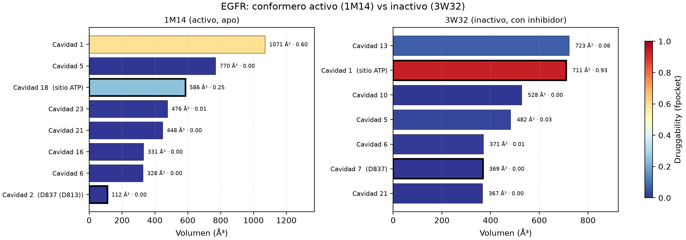
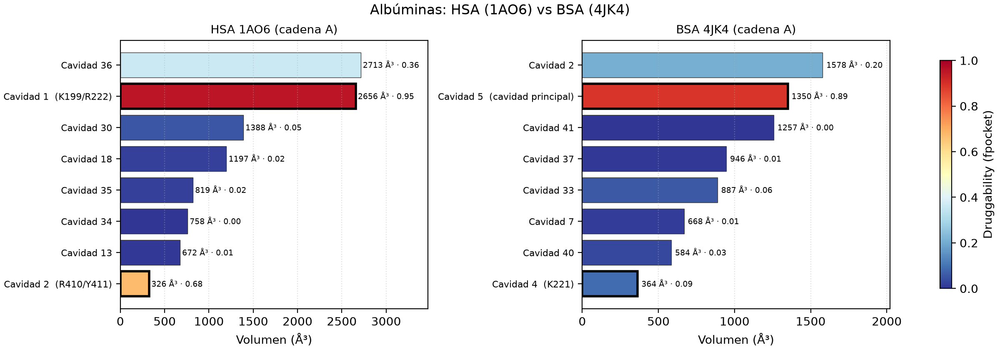
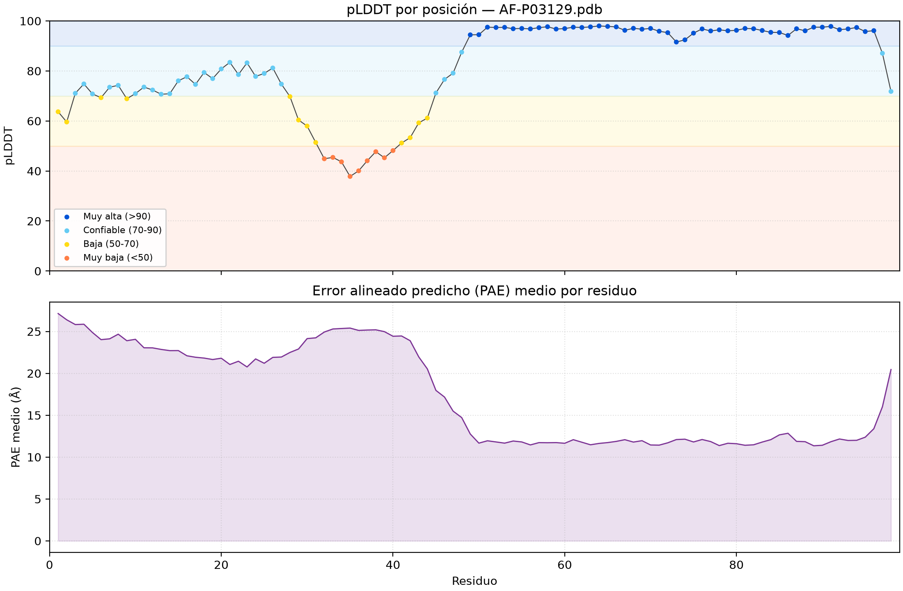

# La vida en tres dimensiones

**Trabajo práctico de Bioinformática Estructural**
Leonardo Criado · noviembre de 2026

> Consigna original: *La vida en tres dimensiones*, Dra. Ana Julia Velez Rueda y Nicolás Palopoli,
> [Introducción a la Bioinformática](https://github.com/AJVelezRueda/Introduccion_a_la_Bioinformatica/blob/master/Teorico_Practicos/Bioinform%C3%A1tica_Estructural/La_vida_en_tres_dimensiones.md) (CC BY-SA 4.0).

> **Nota metodológica.** Al momento de hacer este TP el sitio de **CaviDB** no
> respondía (el dominio estaba caído), así que los desafíos se resolvieron
> reproduciendo el mismo análisis que hace CaviDB con las herramientas que la base
> documenta: **fpocket** para detectar cavidades y **PROPKA** para calcular pKa.
> Todos los números salen de corridas propias, son reproducibles con los scripts
> de este repositorio y se comparan, cuando existen, con los valores publicados de
> CaviDB. Los detalles están en la sección 2.1.

---

## Resumen

Se analizó la estructura de la ubiquitina (1UBQ) y el formato PDB; se compararon
dos conformeros del dominio quinasa de EGFR (1M14 activo *apo* y 3W32 inactivo con
un inhibidor), se anotó la proteína AKR1C4 en UniProt y se estudiaron sus cavidades
en 2FVL; se caracterizaron las cavidades y los pKa de la albúmina humana (1AO6) y
bovina (4JK4); y se predijo la estructura de la proteína E7 del VPH16 con
AlphaFold2/ColabFold, analizando el pLDDT por posición.

Los resultados principales:

- La ubiquitina es una proteína de 76 aminoácidos, resuelta por rayos X a 1,8 Å,
  con una sola cadena y 602 átomos.
- El sitio ATP de EGFR está **abierto y fragmentado** en el conformero activo
  (1M14) y **cerrado y drogable** en el inactivo (3W32; cavidad de 711 ų,
  druggability 0,93).
- La cavidad drogable de AKR1C4 (2FVL, cadena B; 988 ų, druggability 0,85)
  coincide con el sitio catalítico y de unión a NADP.
- En la albúmina humana, la cavidad 1 (sitio AII, 2656 ų) contiene K195, K199 y
  R222 y está **activada**: K199 tiene pKa 6,78 (Δ = −3,72) y R222 9,16
  (Δ = −3,34). La cavidad 2 (sitio AIII) contiene R410/Y411 pero no está activada.
- En la albúmina bovina, el sitio está **invertido**: la lisina catalítica es K221
  (pKa 5,39), que ocupa el lugar de R222 en la humana, mientras que R198 ocupa el
  lugar de K199. K221 está en una subcavidad pequeña (364 ų, no drogable) al borde
  de la cavidad principal.
- El modelo de E7 tiene pLDDT medio 81,3; el dominio C-terminal (61–98) tiene
  pLDDT medio 95,4 y la región N-terminal (1–40) 66,1, con un mínimo de 37,8 en
  32–40. La predicción reproduce el carácter desordenado del extremo N-terminal y
  el dominio C-terminal estructurado con dedos de zinc.

---

## 1. Un problema estructural

### 1.1 ¿Por qué una célula destruiría sus propias proteínas?

La célula no destruye proteínas "porque sí": las degrada de forma **regulada**. La
proteólisis selectiva cumple funciones esenciales:

- **Control de calidad:** elimina proteínas mal plegadas, dañadas o agregadas
  antes de que sean tóxicas.
- **Regulación:** muchas proteínas reguladoras (ciclinas, factores de
  transcripción, inhibidores) deben desaparecer en un momento preciso del ciclo
  celular o de una vía de señalización.
- **Reciclado:** libera aminoácidos para sintetizar otras proteínas, sobre todo en
  situaciones de estrés o ayuno.
- **Presentación de antígenos:** los péptidos degradados por el proteasoma se
  presentan en el MHC-I al sistema inmune.
- **Defensa y homeostasis:** elimina proteínas virales o bacterianas y controla la
  abundancia de proteínas de respuesta inmune.

La **ubiquitina** es la etiqueta clásica de este sistema. Es una proteína pequeña
(76 aminoácidos, ~8,6 kDa) que se une covalentemente a las proteínas sustrato
mediante una cascada de enzimas E1–E2–E3. La cadena de poliubiquitina unida por
lisinas K48 es la señal clásica de degradación por el proteasoma 26S; otras
modificaciones (K63, monoubiquitina) participan en señalización, tráfico
vesicular, reparación del ADN, autofagia e inflamación. Por eso el sistema
ubiquitina–proteasoma no es solo una "máquina de destrucción": es un sistema de
información y control.

### 1.2 La ubiquitina en el PDB

La entrada **1UBQ** de la ubiquitina humana tiene estos datos:

| Dato | Valor |
|---|---|
| Entrada | 1UBQ |
| Proteína | Ubiquitina (Homo sapiens) |
| Método | Difracción de rayos X |
| Resolución | 1,80 Å |
| Factor R (working + test) | 0,176 |
| Cadenas | 1 (A) |
| Residuos | 76 |
| Átomos | 602 sin hidrógenos + 58 aguas |
| Fecha de depósito | 02-01-1987 |
| Artículo | Vijay-Kumar, Bugg & Cook, *J. Mol. Biol.* (1987) |

**¿Qué información nos provee la página del PDB?**
La ficha (*Structure Summary*) reúne: identificador y título de la entrada; autores
y fechas; método experimental y resolución; estadísticas de refinamiento
(R y R-free); grupo espacial y celda unidad; la **asamblea biológica**; las
cadenas con su secuencia; ligandos, cofactores, iones y aguas; enlaces a bases de
datos (UniProt, Pfam, GO, CATH, SCOP); la citación; métricas de validación
(Ramachandran, choques estéricos, rotámeros); el visor 3D; y las opciones de
descarga (PDB, mmCIF, FASTA, factores de estructura).

**¿Cómo se determinó la estructura de esta proteína?**
Por **cristalografía de rayos X**. El procedimiento, en grandes pasos: se purifica
la proteína, se cristaliza, se difracta con rayos X (en un tubo o en un
sincrotrón), se indexan e integran las reflexiones, se escalan los datos, se
obtienen las fases (por reemplazo molecular, dispersión anómala o métodos
experimentales), se calcula el mapa de densidad electrónica, se construye el
modelo atómico y se refina contra los datos hasta que el modelo explica el mapa.
La 1UBQ se refinó a 1,8 Å, lo que permite ubicar bien el esqueleto y la mayoría de
las cadenas laterales.

**¿Qué significan las cintas, las flechas y las regiones angostas?**
Es una representación **cartoon** de la estructura secundaria, no de los átomos:
las **flechas** son hebras β (en la ubiquitina hay cinco, que forman el plegamiento
β-grasp); las **cintas/espirales** son hélices α (la ubiquitina tiene una hélice
α principal, entre los residuos 23 y 34, y una hélice 3₁₀ corta); y las **regiones
angostas** son *loops* o giros que conectan los elementos de estructura secundaria.
Las flechas suelen indicar la dirección N→C de la hebra.

**¿Representa esa imagen la realidad del sistema biológico?**
No literalmente. La imagen es un **modelo**, no una fotografía: muestra una sola
conformación (o un promedio) de las moléculas presentes en el cristal, sin
hidrógenos, sin la mayoría de las aguas y sin las regiones flexibles que no se ven
en el mapa de densidad. Tampoco muestra la dinámica, las modificaciones
postraduccionales, el entorno celular ni los ligandos que la proteína encuentra in
vivo. Es una excelente aproximación al plegamiento y a la arquitectura de la
proteína, pero no es "la proteína real" en toda su complejidad. En palabras
habituales: el mapa no es el territorio.

**Sobre la resolución de 1,8 Å.**
La resolución nominal es la distancia mínima entre planos cristalinos para la que
se midieron reflexiones; se expresa en Å. **Cuanto menor es el número, mayor es la
resolución** y menor la incertidumbre de las posiciones atómicas. Un valor de
1,8 Å es bueno para una proteína de 76 aminoácidos: permite trazar el esqueleto,
asignar la estructura secundaria y ubicar la mayoría de las cadenas laterales; no
permite ver hidrógenos y las zonas con alta movilidad tienen factores B altos o
directamente no se observan. La resolución no es exactamente "el error", pero sí
una medida del nivel de detalle y de la incertidumbre asociada.

**¿Cuál es la utilidad y los condicionamientos de usar un modelo inexacto?**
La utilidad es enorme: un modelo permite formular hipótesis mecanísticas, diseñar
mutantes, interpretar mutaciones patogénicas, comparar conformeros, buscar sitios
de unión y hacer diseño de fármacos. El condicionamiento es usarlo **con su
incertidumbre**: no sobreinterpretar contactos de cadenas laterales, comparar
varias conformaciones, mirar los factores B y las métricas de validación, y
recordar que el modelo es una interpretación de los datos, no un hecho desnudo.
La ciencia trabaja siempre con modelos aproximados; la diferencia entre un buen y
un mal uso no es la ausencia de error, sino la conciencia de ese error.

### 1.3 Del visor 3D al archivo PDB

**¿Qué diferencias y similitudes hay entre la representación inicial y el visor 3D?**
Ambas usan las **mismas coordenadas** de la misma entrada, así que el plegamiento
es idéntico. La diferencia es la interfaz y el nivel de detalle: la imagen inicial
es una vista pre-renderizada, estática y curada; el visor 3D es interactivo,
permite rotar, hacer zoom, desplazar, cambiar la representación (cartoon, sticks,
esferas, superficie), colorear por cadena, estructura secundaria, factor B,
hidrofobicidad o tipo de residuo, y seleccionar ligandos o residuos concretos.

**¿Para qué sirve visualizar lo mismo de distintas maneras?**
Cada representación responde a una pregunta distinta. El cartoon sirve para ver el
plegamiento; los *sticks* para ver interacciones y contactos; la superficie para
ver la forma, las cavidades y la complementariedad; el coloreado por factor B para
ver flexibilidad; el coloreado por cadena para ver la ensambladura; el coloreado
por conservación o por mutaciones para ver relaciones evolutivas o clínicas. Una
representación es siempre una elección: muestra algo y esconde otra cosa.

**¿Qué información esperaría encontrar como resultado de un experimento
estructural?**
Coordenadas atómicas en Å; método y resolución; medidas de calidad (R, R-free,
validación); secuencia cubierta y residuos no observados; ligandos, cofactores,
iones y aguas; factores B; la asamblea biológica; y los datos experimentales
asociados. Para NMR o criomicroscopía electrónica se esperan, además, múltiples
modelos o mapas de densidad, respectivamente.

**¿En qué consiste un archivo PDB?**
Es un archivo de **texto plano con columnas fijas** (80 caracteres por línea) que
describe la estructura. Cada línea es un **registro** con un formato definido:

| Registro | Contenido |
|---|---|
| `HEADER`, `TITLE`, `COMPND`, `SOURCE` | Identificación, nombre, composición y origen |
| `EXPDTA`, `REMARK` | Método experimental, resolución, refinamiento, validación |
| `SEQRES` | Secuencia completa de cada cadena (en código de 3 letras) |
| `DBREF` | Correspondencia con bases de datos (UniProt, etc.) |
| `HELIX`, `SHEET`, `SSBOND` | Estructura secundaria y puentes disulfuro |
| `CRYST1`, `ORIGX`, `SCALE` | Celda unidad y transformaciones de coordenadas |
| `ATOM` | Átomos de la macromolécula, con coordenadas |
| `HETATM` | Ligandos, cofactores, iones, aguas |
| `TER`, `CONECT`, `MASTER`, `END` | Fin de cadena, conectividad, control y fin de archivo |

**La sección ATOM.**
Cada línea `ATOM` describe un átomo:

| Columnas | Campo | Ejemplo (primer átomo de 1UBQ) |
|---|---|---|
| 1–6 | Registro | `ATOM` |
| 7–11 | Número de serie | `1` |
| 13–16 | Nombre del átomo | `N` |
| 17 | Conformación alterna | ` ` |
| 18–20 | Residuo (3 letras) | `MET` |
| 22 | Cadena | `A` |
| 23–26 | Número de residuo | `1` |
| 27 | Código de inserción | ` ` |
| 31–38 | Coordenada x (Å) | `27.340` |
| 39–46 | Coordenada y (Å) | `24.430` |
| 47–54 | Coordenada z (Å) | `2.614` |
| 55–60 | Ocupancia | `1.00` |
| 61–66 | Factor B (Ų) | `9.67` |
| 77–78 | Elemento | `N` |
| 79–80 | Carga | ` ` |

La sección `ATOM` da, entonces, la identidad química de cada átomo, el residuo y la
cadena a la que pertenece, su número, sus coordenadas tridimensionales, su
ocupancia (cuántas veces aparece esa conformación) y su factor B (movilidad o
incertidumbre). Es una **tabla de coordenadas**, no una secuencia.

**¿Podemos extraer la estructura primaria del archivo?**
Sí, por dos vías complementarias:

- `SEQRES` da la secuencia **completa** de cada cadena, en código de tres letras;
  pasándola a una letra se obtiene la secuencia primaria.
- `ATOM` da los residuos **observados** en el mapa, en orden; puede faltar alguno
  (regiones desordenadas, extremos flexibles) y puede haber microheterogeneidad.

Desde el punto de vista computacional, `SEQRES` es una **cadena de caracteres**
(una lista de símbolos), mientras que `ATOM` es una **tabla de registros** con
números reales (las coordenadas) y enteros (residuo, cadena). La secuencia es el
orden de los residuos; las coordenadas son la geometría. En 1UBQ ambas coinciden:
`MQIFVKTLTGKTITLEVEPSDTIENVKAKIQDKEGIPPDQQRLIFAGKQLEDGRTLSDYNIQKESTLHLVLRLRGG`
(76 aa). En muchas estructuras no coinciden exactamente, y ahí está la información
de qué partes del modelo están resueltas y cuáles no.

**¿Es útil el formato PDB para presentar los resultados del experimento?**
Es útil y fue durante décadas el estándar de facto, pero tiene límites claros.

*Ventajas:* es simple, de texto, legible por humanos y por casi cualquier
programa; contiene coordenadas y metadatos en el mismo archivo; fue adoptado por
toda la comunidad; permite reconstruir la estructura y compararla.

*Limitaciones:* las columnas fijas de 80 caracteres obligan a abreviar y a veces
pierden información; el formato no tiene un diccionario de datos formal tan
estricto como mmCIF; la precisión de las coordenadas es limitada; las estructuras
grandes o con muchos modelos se vuelven incómodas; la anotación es heterogénea; y
el PDB "clásico" fue reemplazado como formato maestro por **PDBx/mmCIF**, que es
más expresivo y escalable. Para *presentar* resultados, el PDB es necesario pero
no suficiente: sin resolución, R, validación y factores B, las coordenadas solas
pueden dar una falsa sensación de exactitud.

**Beneficios y limitaciones de imponer una estructura para comunicar resultados.**
*Beneficios:* interoperabilidad (todos leen lo mismo), automatización, validación
cruzada, comparabilidad entre experimentos, posibilidad de construir bases de
datos y de reproducir análisis, y claridad semántica sobre qué es cada campo.
*Limitaciones:* todo esquema pierde matices; lo que no entra en el formato se
pierde o se anota mal; los formatos envejecen; la rigidez puede forzar
interpretaciones; y la existencia de un campo no garantiza que su contenido sea
correcto. Un estándar es una convención social y técnica, no una verdad natural:
hay que usarlo sabiendo qué deja afuera.

### 1.4 ¿Y los ácidos nucleicos?

Sí: los ácidos nucleicos también tienen estructura tridimensional y se estudian
con la misma lógica. El ADN forma una doble hélice con dos cadenas antiparalelas
unidas por puentes de hidrógeno entre bases complementarias (A–T, G–C) y apiladas
en el interior; el esqueleto de azúcar–fosfato queda afuera. Hay varias formas:
**B-DNA** (la clásica, ~10 pb/vuelta, paso de 34 Å, diámetro ~20 Å), **A-DNA**
(~11 pb/vuelta, más compacta) y **Z-DNA** (levógira, ~12 pb/vuelta). El ARN suele
ser monocatenario y se pliega sobre sí mismo: horquillas, tRNAs con forma de L,
ribozimas, riboswitches y aptámeros, con apareamientos canónicos y no canónicos,
apilamiento de bases e iones que estabilizan la estructura.

El PDB contiene estructuras de ADN, ARN y complejos proteína–ácido nucleico, y el
formato es el mismo (ATOM/HETATM). Las diferencias están en la química: el ARN
tiene 2'-OH, uracilo en lugar de timina, y una geometría de azúcar distinta; es más
flexible y depende más de iones y de proteínas. Por eso la predicción de estructura
de ácidos nucleicos es más difícil que la de proteínas, y los métodos actuales
(AlphaFold3, RoseTTAFold NA, etc.) todavía están menos maduros que AlphaFold2 para
proteínas.

### 1.5 Rosalind Franklin

Rosalind Elsie Franklin (1920–1958) fue una química y cristalógrafa británica. Se
formó en Cambridge, trabajó en París con Jacques Mering en la difracción de rayos X
de carbones y materiales desordenados, y en 1951 se incorporó al King's College de
Londres para estudiar la estructura del ADN con Maurice Wilkins.

Sus **procedimientos** fueron experimentales y cuantitativos:

- Preparaba **fibras de ADN** orientadas y controlaba con precisión la humedad
  relativa, lo que le permitió distinguir dos formas: la **A** (más seca) y la
  **B** (más hidratada).
- Obtenía **patrones de difracción de rayos X** de esas fibras, con exposiciones
  largas y cámaras especiales; la famosa **Foto 51** (tomada con Raymond Gosling en
  1952) es un patrón de la forma B.
- Analizaba los patrones midiendo las posiciones e intensidades de las capas y
  aplicando la teoría de difracción helicoidal para inferir parámetros: período de
  la hélice, número de bases por vuelta, radio, simetría y orientación de las bases.
- Construía y contrastaba modelos con esos datos, y fue muy cuidadosa en distinguir
  lo que los datos permitían afirmar de lo que era especulación.

A partir de sus medidas se establecieron parámetros de la forma B (alrededor de
10 pb por vuelta, paso de ~34 Å, diámetro de ~20 Å, bases hacia adentro). Sus datos
fueron mostrados a James Watson sin su consentimiento por Wilkins, y fueron
centrales para el modelo de la doble hélice publicado por Watson y Crick en 1953.
Ese mismo año salieron tres artículos en *Nature*: el de Franklin y Gosling sobre
la forma B, el de Wilkins y colaboradores, y el de Watson y Crick. Franklin no
publicó una "foto" y nada más: produjo un cuerpo de mediciones y un análisis
cuantitativo sin el cual el modelo no se sostenía.

Después se mudó al Birkbeck College, donde estudió la estructura del virus del
mosaico del tabaco (TMV) y de otros virus, y siguió trabajando hasta su muerte por
cáncer de ovario en 1958, a los 37 años. El Premio Nobel de 1962 fue para Watson,
Crick y Wilkins; Franklin había muerto y el Nobel no se otorga póstumamente. Su
reconocimiento llegó tarde, y hoy es un caso emblemático de cómo la ciencia también
se escribe con jerarquías, acceso a datos y crédito desigual.

---

## 2. Una solución en el bolsillo

Las proteínas no son ovillos: adoptan estructuras definidas que se describen en
cuatro niveles (primaria, secundaria, terciaria y cuaternaria). Desde Anfinsen
sabemos que la secuencia contiene la información para el plegamiento, aunque in
vivo el plegamiento ocurre en un entorno celular complejo y con ayuda de
chaperonas. Además, las proteínas no están quietas: son **ensambles
conformacionales** que se mueven, y esa dinámica es parte de la función.

En la superficie, una proteína tiene cavidades, canales y protuberancias que crean
microambientes para unir ligandos o catalizar reacciones. La forma y las
propiedades fisicoquímicas de esas cavidades (volumen, hidrofobicidad, carga,
residuos ionizables, pKa) determinan si un ligando puede unirse y si la cavidad es
"drogable". De ahí el interés en detectarlas computacionalmente: fpocket, CaviDB,
PocketFinder, DoGSiteScorer, etc.

### 2.1 Cómo se analizaron las cavidades en este TP

Como CaviDB no estaba disponible, se reprodujo su pipeline sobre las cadenas
indicadas por la consigna:

1. **Descarga y preparación:** estructuras del RCSB PDB; se aisló la cadena de
   interés con Biopython y se eliminaron aguas y heteroatomos (ligandos,
   cofactores, iones) para comparar todas las estructuras en las mismas
   condiciones. Las cadenas usadas fueron 1M14:A, 3W32:A, 2FVL:B, 1AO6:A y 4JK4:A.
2. **Detección de cavidades:** **fpocket 4.2.3** (conda-forge) con parámetros por defecto. Se
   consideró **drogable** una cavidad con *druggability score* > 0,5, el mismo
   criterio que usa CaviDB.
3. **pKa:** **PROPKA 3.5.1** a pH 7 sobre cada cadena. Se calculó el corrimiento
   respecto de los valores del modelo de PROPKA (Asp 3,8; Glu 4,5; His 6,5;
   Cys 9,0; Tyr 10,0; Lys 10,5; Arg 12,5) y el corrimiento neto por cavidad. Los
   valores 99,99 que PROPKA usa para residuos sin desprotonación posible se
   excluyeron de los promedios.
4. **Análisis:** se cruzaron las cavidades con los residuos de interés (sitio
   activo, residuos catalíticos, mutaciones) y se calcularon estadísticos de pKa
   por cavidad.

**Límites de esta reproducción.** Se analiza una sola conformación por estructura,
sin hidrógenos explícitos ni cofactores, y fpocket puede fragmentar cavidades
abiertas o dividir un sitio grande en subcavidades. Los volúmenes pueden variar
levemente entre corridas. Por eso los números deben leerse como una estimación
consistente, no como un valor único y absoluto. Cuando existen, se comparan con los
valores publicados de CaviDB y del trabajo de albúminas del grupo de la UNQ.

---

## 3. Desafíos

### Desafío I — El sitio activo de EGFR en dos conformeros

**Consigna:** comparar el sitio activo de los conformeros 1M14 (activo) y 3W32
(inactivo) en la posición 837 y comparar los tamaños de las cavidades.

**Un detalle de numeración que cambia la respuesta.** La 1M14 numera la cadena A
con un corrimiento de −24 respecto de la numeración canónica de EGFR (DBREF:
671–998 en el PDB ↔ 695–1022 en UniProt P00533). Por eso:

- En **1M14**, el residuo 837 es **Leu861**, y el **Asp837 catalítico** es el
  residuo local **813**.
- En **3W32**, la numeración es canónica y el **Asp837** es el 837.

Comparar "el residuo 837" sin corregir esto lleva a conclusiones falsas.

**Resultados de fpocket y de accesibilidad**

| | 1M14 (activo, apo, 2,6 Å) | 3W32 (inactivo, con inhibidor W32, 1,8 Å) |
|---|---|---|
| Cavidades predichas | 24 | 21 |
| Cavidades drogables | 1 (cavidad 1, 1071 ų, 0,60) | 1 (cavidad 1, 711 ų, 0,93) |
| Cavidad del sitio ATP | fragmentada: cavidad 18 (586 ų, 0,25), 19 (297 ų), 24 (256 ų); C797 no pertenece a ninguna | cavidad 1 (711 ų, 0,93), única y bien definida |
| Cavidad que contiene Asp837 | cavidad 2 (112 ų, 0,001); Asp837 = **Asp813** local | cavidad 7 (369 ų, 0,001) |
| SASA de Asp837 | 15,4 Ų | 6,4 Ų |
| SASA de K745 / T790 / M793 / D855 / F856 / L858 | 43,0 / 9,3 / 15,2 / 34,7 / 4,3 / 32,6 Ų | 0,0 / 0,0 / 6,0 / 0,0 / 0,0 / 0,0 Ų |
| Puente salino K745–E762 | 3,8 Å (presente) | 13,6 Å (roto) |



**¿Qué se observa?**

1. **La conformación activa tiene el sitio ATP abierto.** En 1M14, el puente
   salino K745–E762 (marca de la hélice αC "adentro", conformación activa) está
   presente (3,8 Å), y los residuos del sitio ATP están mucho más expuestos al
   solvente: K745, T790, D855, F856 y L858 pasan de SASA ~0 en 3W32 a 9–43 Ų en
   1M14. fpocket no encuentra una única cavidad cerrada: el sitio está abierto y se
   fragmenta en varias subcavidades (18, 19, 24).
2. **La conformación inactiva tiene el sitio cerrado y drogable.** En 3W32 el
   puente salino está roto (13,6 Å) y el sitio ATP es una cavidad única, profunda y
   con druggability 0,93, que alojaba al inhibidor W32. Los 21 residuos que rodean
   al ligando (L718, G719, S720, V726, A743, K745, M766, C775, R776, L777, L788,
   T790, Q791, L792, M793, G796, L844, T854, D855, F856, F997) coinciden con los
   que revisten la cavidad 1. El inhibidor estabiliza la conformación inactiva.
3. **El Asp837 catalítico no está en la cavidad principal del ATP.** Es el aspartato
   del motivo HRD (835–837), en el *loop* catalítico, y está en el borde del sitio.
   En la conformación inactiva está más enterrado (SASA 6,4 Ų) y reviste una
   subcavidad más grande (369 ų) que en la activa (112 ų, SASA 15,4 Ų). Es decir:
   el cambio conformacional no solo agranda o achica un bolsillo, sino que
   **reorganiza** el sitio y cambia la exposición de los residuos catalíticos.

**Interpretación.** El sitio ATP de EGFR es un ejemplo de **selección
conformacional**: la proteína activa tiene un sitio abierto y accesible, mientras
que la inactiva tiene un bolsillo cerrado y complementario a inhibidores. Los
inhibidores de tipo "DFG-out" o los alostéricos aprovechan justamente esa
conformación. La comparación también muestra que "tamaño de la cavidad" no es
sinónimo de "druggability": la cavidad 1 de 1M14 es más grande (1071 ų) pero
mucho menos drogable (0,60) que la de 3W32 (711 ų, 0,93), porque su forma es más
abierta y menos complementaria.

**Cautelas.** 1M14 es *apo* y 3W32 es *holo* (aunque el ligando se eliminó para el
análisis); las resoluciones difieren (2,6 vs 1,8 Å); y fpocket está sesgado hacia
cavidades cerradas, por lo que un sitio abierto puede aparecer fragmentado. La
dirección de los cambios (más exposición en el activo, más bury en el inactivo) es
robusta y coincide con los indicadores estructurales independientes (puente salino
y contactos del ligando).

### Desafío II — AKR1C4 en UniProt

**Proteína:** aldo-keto reductasa familia 1, miembro C4 (AKR1C4; UniProt
[P17516](https://www.uniprot.org/uniprotkb/P17516/entry)), 323 aminoácidos.
Es una enzima citosólica dependiente de NADPH que reduce cetosteroides a
hidroxiesteroides, con actividad 3α-hidroxiesteroide deshidrogenasa; participa en el
metabolismo de esteroides, ácidos biliares y fármacos.

**Sitios anotados en UniProt**

| Anotación | Posición | Relevancia |
|---|---|---|
| Sitio activo (dador de protones) | Y55 | Tirosina catalítica; su pKa determina la catálisis |
| Sitio que baja el pKa de Y55 | K84 | Lisina que estabiliza la tirosinato |
| Unión a cofactor/NADP | 20–24, 166–167, 190, 216–221, 270–280 | Bolsillo de NADP(H) |
| Unión a sustrato/esteroide | 50, 190, 216–221 | Contactos con el anillo esteroideo |
| Tetrada catalítica | D50, Y55, K84, H117 | Red de protones y estabilización |

Las variantes naturales anotadas son G135E (rs11253043), S145C (rs3829125),
C170Y (rs17851824), Q250R (rs4880718) y L311V (rs17134592). La variante **S145C**
se asoció con niveles bajos de progesterona y con historia de irritabilidad
maníaca/hipomaníaca en varones con trastorno bipolar (Johansson et al., 2011), y
otros polimorfismos de AKR1C4 se han estudiado en relación con ideación paranoide
durante episodios maníacos. Es importante notar que **S145 está lejos del sitio
activo** (~20 Å de Y55/H117/K84/D50 y del NADP en 2FVL): su efecto probablemente
no sea catalítico directo, sino de estabilidad, plegamiento o regulación. Es un
buen ejemplo de por qué anotar una variante no es lo mismo que entender su
mecanismo.

### Desafío III — Las cavidades de 2FVLB

**Estructura:** 2FVL, cadena B (2FVLB), AKR1C4 unida a NADP⁺, difracción de rayos X
a 2,4 Å. Se eliminó el NADP para el análisis, de modo que el bolsillo del cofactor
queda vacío.

| | Resultado |
|---|---|
| Cavidades predichas | **21** |
| Cavidades drogables (druggability > 0,5) | **1** |
| Cavidad drogable | cavidad 1: 988 ų, druggability 0,851 |
| Residuos de la cavidad 1 | Y55, H117, D50, G22, T23, S217, R223, N167, S166, W227, etc. |
| ¿Coincide con un sitio relevante? | **Sí**: es el sitio catalítico y de unión a NADP |

La cavidad 1 contiene tres de los cuatro residuos de la tetrada catalítica
(D50, Y55, H117) y varios residuos que contactan el NADP (G22, T23, S217, R223,
N167). K84 no quedó asignada a la cavidad por fpocket, pero está a **2,89 Å** del
OH de Y55, en el borde del sitio; su función es justamente modular el pKa de la
tirosina. Es una cavidad grande, única y drogable: un bolsillo atractivo para
inhibidores, aunque la selectividad frente a las otras isoformas de AKR1C (muy
similares) es el problema central del diseño.

**pKa (PROPKA, sin NADP):** H117 1,52 (muy ácido), Y55 11,24, K84 12,27. Estos
valores no deben tomarse como los pKa fisiológicos definitivos: la ausencia del
cofactor y de hidrógenos explícitos afecta el cálculo. Lo robusto es la
identificación del sitio, no el valor absoluto.

**Cautela:** CaviDB puede reportar un número de cavidades algo distinto según cómo
separe el sitio del NADP y según la versión de fpocket. Nuestra corrida da 21 y una
sola cavidad drogable, que es la conclusión relevante.

### Desafío IV — La albúmina humana (1AO6A)

**Estructura:** 1AO6, cadena A, albúmina sérica humana (HSA), 2,5 Å, sin ligandos
(albúmina "defatted"). La HSA tiene tres dominios homólogos (I, II y III), cada uno
con dos subdominios (A y B); los sitios de unión a fármacos más importantes son el
**sitio I** (subdominio IIA, Sudlow I) y el **sitio II** (subdominio IIIA,
Sudlow II).

| | Resultado |
|---|---|
| Cavidades predichas | **36** |
| Cavidades drogables | **2** (cavidad 1: 2656 ų, 0,955; cavidad 2: 326 ų, 0,675) |
| Cavidades más grandes | 36 (2713 ų, 0,36), 1 (2656 ų, 0,955), 30 (1388 ų, 0,05), 18 (1197 ų, 0,02) |
| Cavidad del sitio I (AII) | **cavidad 1**, 2656 ų, 65 residuos, druggability 0,955 |
| Cavidad del sitio II (AIII) | **cavidad 2**, 326 ų, druggability 0,675 |



**¿Se solapan las cavidades con los residuos relevantes?**

- **K195, K199, R222, W214, R218, H242** están en la **cavidad 1** (sitio AII).
  La cavidad 1 es la segunda más grande de la proteína (la 36 es apenas mayor pero
  no es drogable), lo que coincide con la descripción del sitio AII como una de las
  cavidades principales.
- **R410 y Y411** están en la **cavidad 2** (sitio AIII).
- **C34** no pertenece a ninguna cavidad predicha: está en una grieta superficial,
  accesible, consistente con su papel de tiol libre reactivo y con su participación
  en reacciones redox/antioxidantes.
- **K195** también está en la cavidad 1, junto con K199 y R222.

**pKa y cavidades activadas**

| Residuo | pKa calculado | pKa esperado | Δ |
|---|---|---|---|
| K199 | 6,78 | 10,50 | **−3,72** |
| R222 | 9,16 | 12,50 | **−3,34** |
| R218 | 10,84 | 12,50 | −1,66 |
| K195 | 9,99 | 10,50 | −0,51 |
| R410 (cavidad 2) | 11,99 | 12,50 | −0,51 |
| Y411 (cavidad 2) | 11,19 | 10,00 | +1,19 |

La **cavidad 1** tiene 27 residuos ionizables, con un rango de pKa de 1,31 a 14,12
y un promedio de 8,43; el corrimiento neto absoluto es 40,6. Lo importante no es el
promedio (la cavidad es enorme y heterogénea) sino que **K199 y R222 están
anormalmente acidificados**. Esa acidificación es la firma de una cavidad
"activada": un ambiente hidrofóbico con residuos básicos cercanos (R218, R222,
K195) que desestabiliza la forma protonada de la lisina y de la arginina y baja su
pKa. Es exactamente lo que se necesita para una catálisis promiscua: una lisina que
pueda actuar como base/nucleófilo a pH fisiológico.

La **cavidad 2** (sitio AIII) tiene 6 residuos ionizables, rango 11,19–13,51,
promedio 12,23 y corrimiento neto 2,7: **no** está activada. R410 y Y411 no muestran
un corrimiento fuerte.

**Comparación con CaviDB.** El trabajo de CaviDB reporta para 1AO6A una Lys199 con
pKa ~7,51 y una Arg222 ~9,49, y describe la cavidad 1 como la cavidad grande del
sitio AII con esas dos "residuos activados". Nuestros valores (6,78 y 9,16) son
algo más ácidos, pero reproducen el mismo fenómeno y el mismo ordenamiento. Las
diferencias son esperables: una sola conformación, sin hidrógenos explícitos, sin
ligandos, y una versión de PROPKA distinta.

**Respuestas puntuales**

- *¿Cuántas cavidades fueron predichas?* 36.
- *¿Cuáles son las principales por tamaño?* 36 (2713 ų), 1 (2656 ų), 30
  (1388 ų), 18 (1197 ų); la más relevante funcionalmente es la 1.
- *¿Hay cavidades que se solapen con los residuos relevantes?* Sí: cavidad 1 con
  K195/K199/R222/W214; cavidad 2 con R410/Y411; C34 no está en ninguna.
- *¿Alguna cavidad catalíticamente activa está activada?* Sí, la cavidad 1 (sitio
  AII): K199 y R222 tienen pKa anormalmente ácidos.
- *¿Qué rangos de pKa se observan?* En la cavidad 1, 1,31–14,12 (promedio 8,43);
  los residuos catalíticos, 6,78 (K199) y 9,16 (R222). En la cavidad 2,
  11,19–13,51 (promedio 12,23).

### Desafío V — La albúmina bovina (4JK4A) y la inversión del sitio

**Estructura:** 4JK4, cadena A, albúmina sérica bovina (BSA) en complejo con ácido
3,5-diiodosalicílico, 2,65 Å. Se eliminaron los ligandos para el análisis.

| | Resultado |
|---|---|
| Cavidades predichas | **41** |
| Cavidades drogables | **3**: cavidad 1 (498 ų, 0,952), cavidad 3 (436 ų, 0,552), cavidad 5 (1350 ų, 0,893) |
| Cavidad principal del sitio AII | **cavidad 5**, 1350 ų, 33 residuos, druggability 0,893; contiene W213, R198, R217, K187, etc. |
| Cavidades que contienen K221 | cavidad 4 (364 ų, 0,086) y cavidad 38 (566 ų, 0,002); **no** la cavidad 5 |

**pKa en BSA**

| Residuo | pKa calculado | pKa esperado | Δ |
|---|---|---|---|
| K221 | **5,39** | 10,50 | **−5,11** |
| R198 | 9,07 | 12,50 | −3,43 |
| R217 | 10,48 | 12,50 | −2,02 |

K221 está a **2,9 Å** de R217, una repulsión electrostática fuerte, y además está
poco solvatada (el término de desolvatación es −2,69 kcal/mol): eso explica su pKa
tan bajo. Es el mismo tipo de mecanismo que acidifica a R222 en la HSA, donde R222
está a 4,3 Å de R218.

**La comparación con la HSA**

| | HSA (1AO6A) | BSA (4JK4A) |
|---|---|---|
| Par de residuos del sitio | K199 / R222 | R198 / K221 |
| Lisina catalítica (ácida) | **K199**, pKa 6,78 | **K221**, pKa 5,39 |
| Residuo equivalente al otro miembro del par | R222, pKa 9,16 | R198, pKa 9,07 |
| Cavidad que contiene la lisina catalítica | cavidad 1 (2656 ų, 0,955) | cavidad 4 (364 ų, 0,086) |
| Cavidad principal del sitio AII | cavidad 1 (drogable) | cavidad 5 (1350 ų, 0,893) |

La conclusión es que el sitio activo de la albúmina **no está simplemente
"corrido"**: está **invertido**. En la HSA el par es Lys/Arg (K199/R222) y la lisina
ácida es K199; en la BSA el par es Arg/Lys (R198/K221) y la lisina ácida es K221.
Los dos residuos intercambiaron sus posiciones funcionales, y la selección natural
mantuvo un par ácido/base con pKa anómalos en ambos casos. Es una adaptación
interesante: lo que se conserva no es la identidad de los residuos, sino la
**propiedad fisicoquímica** (un residuo básico con pKa bajo) y la geometría de la
cavidad.

Las diferencias de drogabilidad también son sugerentes: en la HSA la lisina
catalítica está dentro de la cavidad principal, grande y drogable; en la BSA está
en una subcavidad más pequeña y no drogable, en el borde de la cavidad principal.
Eso podría explotarse para diseñar ligandos selectivos de especie, aunque hay que
tomarlo con cautela porque fpocket puede partir un sitio grande en subcavidades
según la forma del bolsillo.

**Comparación con la literatura.** El trabajo del grupo de la UNQ (Biochimie, 2022)
describe exactamente esta inversión y reporta pKa promedio de ~7,51 para K199 y
~9,49 para R222 en HSA, y ~9,24 para R198 y ~7,27 para K221 en BSA. Nuestros
valores son más ácidos (6,78; 9,16; 9,07; 5,39), pero la tendencia y la inversión
se reproducen. La diferencia cuantitativa es esperable por la metodología (una
conformación, sin hidrógenos, PROPKA 3.5.1).

**Respuestas puntuales**

- *¿Cuántas cavidades tiene 4JK4A?* 41; 3 drogables.
- *¿Dónde está K221?* En las cavidades 4 (364 ų, no drogable) y 38 (566 ų, no
  drogable), no en la cavidad principal 5.
- *¿Cómo se compara con la HSA?* El sitio está invertido: la lisina catalítica es
  K221 en BSA y K199 en HSA; ambas tienen pKa anormalmente bajos (5,39 y 6,78),
  pero la de BSA está en una subcavidad pequeña y no drogable, mientras que la de
  HSA está en la cavidad principal drogable.

### Para investigar — Docking

El **docking molecular** predice cómo se une un ligando a un receptor: busca
posiciones, orientaciones y conformaciones del ligando dentro de una cavidad y las
puntúa con una **función de scoring** que aproxima la energía de unión. Sus ideas
básicas son:

- **Muestreo:** explorar el espacio de poses (traslación, rotación, torsiones del
  ligando; a veces también flexibilidad del receptor).
- **Scoring:** estimar la afinidad con campos de fuerza, términos empíricos o
  funciones basadas en conocimiento; suelen incluir van der Waals, electrostática,
  puentes de hidrógeno, desolvatación y entropía.
- **Búsqueda:** algoritmos genéticos, Monte Carlo, docking incremental, o métodos
  de aprendizaje profundo (DiffDock, etc.).
- **Validación:** re-docking de un ligando conocido y comparación con la pose
  cristalográfica (RMSD), curvas ROC, energía vs. pose.

Sus límites son importantes: la flexibilidad del receptor, las aguas mediadoras,
la protonación, los cambios conformacionales inducidos y la entropía son difíciles
de capturar; el scoring no es una energía libre exacta. Por eso el docking se usa
para **priorizar** compuestos y generar hipótesis, no para afirmar que un compuesto
funciona.

En el caso de AKR1C4, el docking podría aprovecharse para buscar inhibidores
selectivos del sitio catalítico (Y55/H117/K84/D50) o del bolsillo de NADP, y para
filtrar bibliotecas antes de ensayos enzimáticos. El objetivo terapéutico
hipotético sería modular el metabolismo de progesterona y neuroesteroides (por
ejemplo, la producción de alopregnanolona), que se ha relacionado con síntomas del
trastorno bipolar. Pero hay dos advertencias: (i) las isoformas AKR1C1–C4 son muy
similares, así que la selectividad es el desafío central; y (ii) la variante S145C
está lejos del sitio activo, por lo que su efecto —si es causal— no se explicaría
por un docking en el sitio catalítico, sino por estabilidad, tráfico o interacciones
alostéricas. El docking es una herramienta de hipótesis, no una prueba de eficacia.

---

## 4. Un modelo a seguir

Predecir la estructura tridimensional a partir de la secuencia fue un problema
abierto durante más de 50 años. Los métodos computacionales se agrupan en tres
familias:

1. **Ab initio / de novo:** usan la física y la búsqueda conformacional (dinámica
   molecular, Monte Carlo, optimización) sin depender de estructuras homólogas.
   Son costosos y propensos a imprecisiones, pero pueden explorar plegamientos
   nuevos.
2. **Modelado por homología:** usan una proteína con estructura conocida
   ("plantilla") y la secuencia de la proteína objetivo; funcionan muy bien cuando
   hay un homólogo cercano, y se basan en alineamientos y en la conservación del
   esqueleto.
3. **Aprendizaje automático:** aprenden patrones de grandes conjuntos de
   estructuras. AlphaFold2 es el ejemplo más conocido: usa alineamientos múltiples
   de secuencias (MSAs) y una representación de pares de residuos, con una red
   neuronal (Evoformer + módulo estructural) que predice coordenadas y confianza.

AlphaFold2 reporta dos métricas de confianza:

- **pLDDT** (*predicted local distance difference test*): confianza local por
  residuo, de 0 a 100. >90 muy alta (alta confianza en cadenas laterales), 70–90
  confiable (esqueleto), 50–70 baja, <50 muy baja (a menudo regiones
  desordenadas).
- **PAE** (*predicted aligned error*): error esperado entre pares de residuos
  cuando se alinean las estructuras predicha y real sobre un residuo; en Å. Un PAE
  bajo entre dos dominios indica que su orientación relativa está bien predicha;
  un PAE alto indica incertidumbre en la disposición relativa.

### Desafío VI — E7 del VPH16 con ColabFold

**Procedimiento en ColabFold.** Se abre el notebook
[AlphaFold2.ipynb](https://colab.research.google.com/github/sokrypton/ColabFold/blob/main/AlphaFold2.ipynb),
se pega la secuencia de E7 en `query_sequence`, se elige un `jobname`, se fija
`num_relax = 1` y `template_mode = "pdb100"`, y se ejecuta `Runtime → Run all`.
La secuencia es:

```
MHGDTPTLHEYMLDLQPETTDLYCYEQLNDSSEEEDEIDGPAGQAEPDRAHYNIVTFCCKCDSTLRLCVQSTHVDIRTLEDLLMGTLGIVCPICSQKP
```

**¿Qué es `template_mode` y qué opciones acepta?**
Controla si ColabFold usa plantillas estructurales para la predicción:

- `"none"`: no usa plantillas; predice solo a partir de la secuencia y del MSA.
- `"pdb100"`: busca plantillas en la base **PDB100** (representantes del PDB y
  modelos de AlphaFold DB; antes se llamaba PDB70) y las usa como información
  estructural. Es útil cuando hay homólogos estructurales conocidos.
- `"custom"`: permite subir plantillas propias en formato PDB o mmCIF (nombres de
  cuatro letras en minúscula); el notebook las usa para la búsqueda.

**Resultados.** En este repositorio se analiza el modelo de **AlphaFold DB** para
E7 (AF-P03129-F1, generado con ColabFold 1.5.2, 98 aa, pLDDT global 81,3), porque
la corrida de ColabFold con plantillas requiere GPU y una sesión de Colab. El
script `plot_plddt.py` es exactamente el que se aplica al archivo
`*_relaxed_rank_001_*.pdb` que devuelve esa corrida; si se corre con
`template_mode="pdb100"`, los valores pueden cambiar levemente, pero la conclusión
estructural se mantiene.



| Región | pLDDT medio | Interpretación |
|---|---|---|
| 1–40 | 66,1 | Baja/media; el mínimo está en 32–40 (37,8–47) → región desordenada |
| 41–60 | 85,0 | Confiable |
| 61–98 | **95,4** | Muy alta; 49–96 tienen pLDDT > 90 |

**¿Qué regiones tienen mayor confianza?**
El **dominio C-terminal** (aproximadamente 61–98) es la región de mayor confianza:
pLDDT > 90 en casi toda la mitad C-terminal, con un promedio de 95,4. Es el dominio
con los motivos de dedos de zinc (CXXC) y la estructura globular estable. La región
**N-terminal** (1–40) tiene confianza media/baja y un tramo muy bajo entre 32 y 40,
lo que es consistente con una región **intrínsecamente desordenada** (CR1/CR2, que
incluye el motivo LXCXE de unión a pRb). El PAE acompaña: es alto en el extremo
N-terminal y bajo en el dominio C-terminal, lo que indica que la orientación
relativa del dominio C está bien determinada y la del N-terminal no.

Esto no es un defecto del predictor: es información biológica. E7 es una proteína
pequeña con un extremo N desordenado que media interacciones con socios celulares
y un dominio C estructurado que se une al zinc y dimeriza. AlphaFold2 predice con
alta confianza lo que es estable y con baja confianza lo que es flexible.

**El script `plot_plddt.py`**

- Lee el archivo PDB y toma el pLDDT de la columna B-factor de los átomos CA.
- Grafica el pLDDT por número de residuo, coloreado por banda de confianza
  (>90, 70–90, 50–70, <50).
- Opcionalmente grafica el PAE medio por residuo a partir del JSON de PAE.
- Escribe un CSV con `residuo,plddt` y la figura PNG.
- Uso:

```bash
python scripts/plot_plddt.py resultados/colabfold/mi_run_relaxed_rank_001_alphafold2_ptm_model_1_seed_000.pdb \
    --pae resultados/colabfold/mi_run_predicted_aligned_error_v1.json \
    --salida resultados/figuras/plddt_E7.png \
    --csv resultados/tablas/plddt_E7.csv
```

**Archivos que produce ColabFold.** El notebook genera: `*_template_domain_names.json`
(plantillas usadas), `cite.bibtex`, `config.json` (parámetros de la corrida), `*.a3m`
(alineamiento), `*_coverage.png` (cobertura del MSA), `*_PAE.png` (mapa de PAE),
`*_plddt.png` (pLDDT por posición), `*_predicted_aligned_error_v1.json` (valores de
PAE), los cinco modelos `*_relaxed_*_model_*.pdb` y sus JSON con PAE/pLDDT. Los
modelos relajados con Amber (`num_relax=1`) tienen mejor geometría local; el
pLDDT se calcula antes de la relajación.

---

## 5. Conclusiones

- La estructura tridimensional no es un adorno: es la base física de la función.
  Un archivo PDB es una representación parcial y modelada de esa realidad, y leerlo
  críticamente (resolución, R, B-factors, residuos faltantes) es parte del trabajo
  bioinformático.
- Las cavidades son una forma útil de traducir estructura en función. fpocket y
  CaviDB permiten comparar conformeros, detectar sitios drogables y priorizar
  blancos, pero sus resultados dependen de la conformación, de la presencia de
  ligandos y de la definición de cavidad.
- Los pKa anómalos son una pista funcional fuerte: en la HSA, K199 y R222 están
  acidificados en la cavidad AII; en la BSA, la inversión K/Arg mantiene la
  propiedad fisicoquímica en una geometría distinta. Es un ejemplo lindo de cómo la
  evolución conserva una función a través de soluciones estructurales diferentes.
- AlphaFold2/ColabFold cambiaron el juego: hoy se puede obtener un modelo de alta
  confianza para muchas proteínas sin estructura experimental. Pero el pLDDT y el
  PAE son parte del resultado, no un detalle: indican qué partes del modelo merecen
  confianza y cuáles son probablemente desordenadas o inciertas.
- La biología estructural computacional no reemplaza al experimento: lo orienta, lo
  interpreta y lo complementa.

---

## 6. Referencias

1. Vijay-Kumar S, Bugg CE, Cook WJ. *Structure of ubiquitin refined at 1.8 Å
   resolution.* J Mol Biol. 1987;194(3):531–544. PDB: [1UBQ](https://www.rcsb.org/structure/1UBQ).
2. Berman HM et al. *The Protein Data Bank.* Nucleic Acids Res. 2000;28:235–242.
   [PDB](https://www.rcsb.org/).
3. wwPDB. *PDB file format documentation.*
   [https://www.wwpdb.org/documentation/file-format](https://www.wwpdb.org/documentation/file-format)
4. wwPDB. *PDBx/mmCIF.* [https://mmcif.wwpdb.org/](https://mmcif.wwpdb.org/)
5. Franklin RE, Gosling RG. *Molecular configuration in sodium thymonucleate.*
   Nature. 1953;171:740–741. doi:10.1038/171740a0.
6. Watson JD, Crick FHC. *Molecular structure of nucleic acids.* Nature.
   1953;171:737–738. doi:10.1038/171737a0.
7. Wilkins MHF, Stokes AR, Wilson HR. *Molecular structure of deoxypentose nucleic
   acids.* Nature. 1953;171:738–740. doi:10.1038/171738a0.
8. Maddox B. *Rosalind Franklin: The Dark Lady of DNA.* HarperCollins, 2002.
9. Anfinsen CB. *Principles that govern the folding of protein chains.* Science.
   1973;181:223–230.
10. Le Guilloux V, Schmidtke P, Tufféry P. *Fpocket: an open source platform for
    ligand pocket detection.* BMC Bioinformatics. 2009;10:168.
11. Olsson MHM, Søndergaard CR, Rostkowski M, Jensen JH. *PROPKA3: consistent
    treatment of internal and surface residues in empirical pKa predictions.*
    J Chem Theory Comput. 2011;7(2):525–537.
12. Schmidtke P, Barril X. *Understanding and predicting druggability.* J Med
    Chem. 2010;53:5858–5867.
13. Velez Rueda AJ et al. *CaviDB: a database of cavities and their features in the
    structural and conformational space of proteins.* Database. 2023;baad010.
    doi:10.1093/database/baad010.
    [Artículo](https://academic.oup.com/database/article/7159200)
14. *Structural and evolutionary analysis unveil functional adaptations in the
    promiscuous behavior of serum albumins.* Biochimie. 2022.
    doi:10.1016/j.biochi.2022.02.004.
15. Johansson AGM et al. *AKR1C4 gene variant associated with low euthymic serum
    progesterone and a history of mood irritability in males with bipolar disorder.*
    J Affect Disord. 2011;133(1–2):346–351.
    [PubMed 21570127](https://pubmed.ncbi.nlm.nih.gov/21570127/)
16. UniProt Consortium. *UniProt: the universal protein knowledgebase.*
    [P17516](https://www.uniprot.org/uniprotkb/P17516/entry).
17. Jumper J et al. *Highly accurate protein structure prediction with AlphaFold.*
    Nature. 2021;596:583–589. doi:10.1038/s41586-021-03819-2.
18. Mirdita M et al. *ColabFold: making protein folding accessible to all.*
    Nat Methods. 2022;19:679–682. doi:10.1038/s41592-022-01488-1.
19. Varadi M et al. *AlphaFold Protein Structure Database.* Nucleic Acids Res.
    2022;50:D439–D444.
20. ColabFold. *AlphaFold2.ipynb.*
    [Notebook](https://colab.research.google.com/github/sokrypton/ColabFold/blob/main/AlphaFold2.ipynb)
21. Trott O, Olson AJ. *AutoDock Vina: improving the speed and accuracy of docking
    with a new scoring function, efficient optimization and multithreading.*
    J Comput Chem. 2010;31:455–461.
22. PDB entries: [1M14](https://www.rcsb.org/structure/1M14),
    [3W32](https://www.rcsb.org/structure/3W32),
    [2FVL](https://www.rcsb.org/structure/2FVL),
    [1AO6](https://www.rcsb.org/structure/1AO6),
    [4JK4](https://www.rcsb.org/structure/4JK4).

---

## 7. Cómo reproducir este informe

```bash
# entorno
conda env create -f environment.yml
conda activate tp-estructural

# estructuras y cadenas
bash scripts/descargar_estructuras.sh

# cavidades + pKa
python scripts/analizar_cavidades.py

# figuras
python scripts/figuras_cavidades.py
python scripts/plot_plddt.py data/AF-P03129.pdb \
    --pae data/PAE_P03129.json \
    --salida resultados/figuras/plddt_E7.png \
    --csv resultados/tablas/plddt_E7.csv

# exploración de 1UBQ
python scripts/explorar_pdb.py data/1UBQ.pdb
```

Los resultados quedan en `resultados/tablas/` (`cavidades.csv`, `pka.csv`,
`cavidades_resumen.csv`, `plddt_E7.csv`) y las figuras en `resultados/figuras/`.
