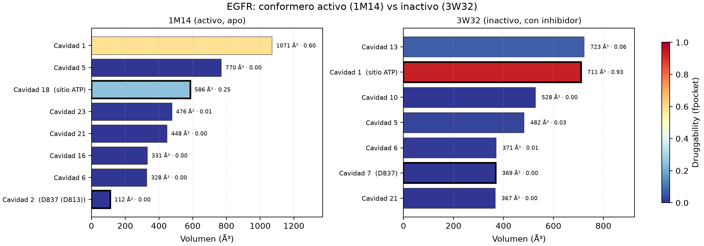

# La vida en tres dimensiones

**Trabajo práctico de Bioinformática Estructural**  
Leonardo Criado · noviembre de 2026

### Desafío I — El sitio activo de EGFR en dos conformeros

> **Consigna original (resumida):** Comparar la posición 837 y el tamaño de los bolsillos en los conformeros activo e inactivo de EGFR. [Fuente](https://github.com/AJVelezRueda/Introduccion_a_la_Bioinformatica/blob/master/Teorico_Practicos/Bioinform%C3%A1tica_Estructural/La_vida_en_tres_dimensiones.md).

**Consigna:** comparar el sitio activo de los conformeros 1M14 (activo) y 3W32
(inactivo) en la posición 837 y comparar los tamaños de las cavidades.

**Un detalle de numeración que cambia la respuesta.** La 1M14 numera la cadena A
con un corrimiento de −24 respecto de la numeración canónica de EGFR (DBREF:
671–998 en el PDB ↔ 695–1022 en UniProt P00533). Por eso:

- En **1M14**, el residuo 837 es **Leu861**, y el **Asp837 catalítico** es el
  residuo local **813**.
- En **3W32**, la numeración es canónica y el **Asp837** es el 837.

Comparar "el residuo 837" sin corregir esto lleva a conclusiones falsas.

**Resultados de fpocket y de accesibilidad**

| | 1M14 (conformación activa, sin ligando, 2,6 Å) | 3W32 (conformación inactiva, con inhibidor W32, 1,8 Å) |
|---|---|---|
| Cavidades predichas | 24 | 21 |
| Cavidades drogables | 1 (cavidad 1, 1071 ų, 0,60) | 1 (cavidad 1, 711 ų, 0,93) |
| Cavidades asignadas a la región del sitio ATP | fragmentada: cavidad 18 (586 ų, 0,25), 19 (297 ų), 24 (256 ų); C797 no pertenece a ninguna | cavidad 1 (710,7 ų, 0,932) |
| Cavidad que contiene Asp837 | cavidad 2 (112 ų, 0,001); Asp837 = **Asp813** local | cavidad 7 (369 ų, 0,001) |
| Residuos del motivo HRD relevantes para la consigna | Asp837 corresponde a Asp813 en la numeración de 1M14 | Asp837 |

**¿Qué se observa?**

1. **Las cavidades difieren entre las estructuras.** En 1M14, fpocket predice 24
   cavidades y separa la zona del sitio ATP entre varias de ellas. En 3W32 predice
   21, incluida una cavidad de 710,7 ų con druggability 0,932. El score resume
   rasgos geométricos de la cavidad; no mide directamente la afinidad del inhibidor.
2. **La numeración del Asp importa.** En la cadena de 1M14, el Asp del motivo HRD
   se numera 813, aunque corresponde al Asp837 de la numeración canónica. En 3W32
   aparece como Asp837. Comparar las cifras sin convertir la numeración llevaría a
   seleccionar residuos distintos.
3. **El tamaño no determina por sí solo la calidad del bolsillo.** La cavidad más
   grande de 1M14 mide 1070,6 ų (score 0,597), mientras que la cavidad 1 de 3W32
   mide 710,7 ų (score 0,932). Esto muestra que el volumen y el score describen
   propiedades distintas. La fragmentación observada también depende del método
   con que se define una cavidad.

**Interpretación.** La comparación muestra que cambios de conformación pueden
cambiar la forma y la partición geométrica del sitio de unión. Los datos de fpocket
son compatibles con una cavidad más definida en 3W32, estructura que contiene el
inhibidor W32. Como no se recalcularon aquí contactos ni accesibilidad al solvente,
no se puede atribuir el cambio observado a un mecanismo único ni concluir que una
conformación tenga mayor actividad a partir de estos scores.

**Cautelas.** Los ligandos y las aguas se retiraron para correr fpocket, aunque las
estructuras de origen no tienen el mismo estado de unión: 1M14 no contiene ligando
y 3W32 está asociada al inhibidor W32. Las resoluciones también difieren (2,6 y
1,8 Å). La SASA, las distancias de contacto y los puentes salinos mencionados en
borradores previos no tienen archivos de cálculo incluidos y por eso no se usan
como resultados verificados en esta versión.

---
