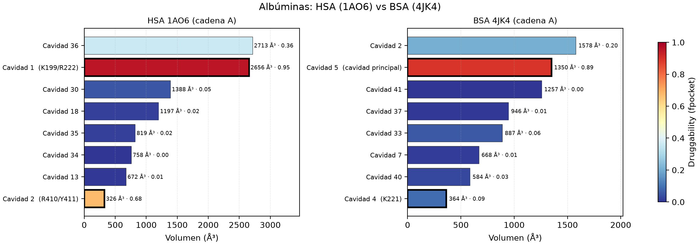

# La vida en tres dimensiones

**Trabajo práctico de Bioinformática Estructural**  
Leonardo Criado · noviembre de 2026

### Desafío IV — La albúmina humana (1AO6A)

> **Consigna :** Consultar CaviDB para la estructura 1AO6A, contar y comparar las cavidades, revisar su solapamiento con residuos de interés y analizar si hay una cavidad potencialmente activada según los pKa. [Fuente](https://github.com/AJVelezRueda/Introduccion_a_la_Bioinformatica/blob/master/Teorico_Practicos/Bioinform%C3%A1tica_Estructural/La_vida_en_tres_dimensiones.md).

**Estructura:** 1AO6, cadena A, albúmina sérica humana (HSA), 2,5 Å, sin ligandos
(albúmina "defatted"). La HSA tiene tres dominios homólogos (I, II y III), cada uno
con dos subdominios (A y B); los sitios de unión a fármacos más importantes son el
**sitio I** (subdominio IIA, Sudlow I) y el **sitio II** (subdominio IIIA,
Sudlow II).

> **Nota :** Cuando hice el trabajo,
> CaviDB no respondía y no pude consultar directamente sus resultados para 1AO6A.
> Por eso analicé las cavidades con fpocket 4.2.3 y los pKa con PROPKA 3.5.1. Usé
> `datos/estructuras/1AO6_A.pdb`, que contiene la cadena A sin aguas ni ligandos.
> Para repetir el análisis ejecuté este comando:
>
> ```bash
> python src/03_analizar_cavidades.py \
>     --estructuras datos/estructuras \
>     --salida resultados
> ```
>
> El script procesa todos los PDB de esa carpeta y guarda las tablas en
> `resultados/`. Para revisar mis resultados del desafío, consulté las filas
> `1AO6_A` de `cavidades.csv` y `pka.csv`. Con este método pude analizar las
> cavidades y los pKa con las herramientas disponibles, pero no reproduje todos
> los pasos ni necesariamente obtuve los mismos resultados que CaviDB.

| | Resultado |
|---|---|
| Cavidades predichas | **36** |
| Cavidades con druggability > 0,5 | **2** (cavidad 1: 2656,5 ų, 0,955; cavidad 2: 325,6 ų, 0,675) |
| Cavidades más grandes | 36 (2713 ų, 0,36), 1 (2656 ų, 0,955), 30 (1388 ų, 0,05), 18 (1197 ų, 0,02) |
| Cavidad del sitio I (AII) | **cavidad 1**, 2656 ų, 65 residuos, druggability 0,955 |
| Cavidad del sitio II (AIII) | **cavidad 2**, 326 ų, druggability 0,675 |



**¿Se solapan las cavidades con los residuos relevantes?**

- **K195, K199, R222, W214, R218 y H242** están en la **cavidad 1** (zona AII).
  La cavidad 1 es la segunda más grande de la proteína (la 36 es apenas mayor pero
  no es drogable), lo que coincide con la descripción del sitio AII como una de las
  cavidades principales.
- **R410 y Y411** están en la **cavidad 2** (zona AIII).
- **C34** no aparece entre los residuos de las cavidades de fpocket. Esto no permite
  concluir por sí solo cuál es su accesibilidad o función química.

**pKa y posibles cavidades activadas**

| Residuo | pKa calculado | pKa esperado | Δ |
|---|---|---|---|
| K199 | 6,78 | 10,50 | **−3,72** |
| R222 | 9,16 | 12,50 | **−3,34** |
| R218 | 10,84 | 12,50 | −1,66 |
| K195 | 9,99 | 10,50 | −0,51 |
| R410 (cavidad 2) | 11,99 | 12,50 | −0,51 |
| Y411 (cavidad 2) | 11,19 | 10,00 | +1,19 |

La **cavidad 1** tiene 27 residuos ionizables. Sus pKa calculados van de 1,31 a
14,12 y el promedio es 8,43. La suma de los valores absolutos de los corrimientos
respecto de los valores de referencia es 40,57; no es un pKa ni una medida directa
de actividad. En particular, PROPKA predice valores menores que los de referencia
para K199 (6,78) y R222 (9,16). Un pKa desplazado indica que el entorno estructural
podría modificar su protonación. CaviDB usa estos desplazamientos para señalar
cavidades que podrían estar activadas, pero este cálculo no demuestra que
K199 o R222 catalicen una reacción ni explica el mecanismo.

La **cavidad 2** (zona AIII) tiene 6 residuos ionizables, rango 11,19–13,51,
promedio 12,23 y suma absoluta de corrimientos 2,71. En los residuos de interés,
los desplazamientos calculados son menores que los de K199 y R222; con estos
resultados no la clasificamos como potencialmente activada.

**Comparación con CaviDB.** Para HSA, la publicación de CaviDB [13] informa pKa calculados
aproximados de 7,51 para K199 y 9,49 para R222. En esta corrida obtuvimos 6,78 y
9,16. Son predicciones calculadas, no mediciones experimentales; la diferencia es
posible porque no se reprodujeron el mismo conjunto de conformaciones y todos los
parámetros del análisis publicado.

**Respuestas puntuales**

- *¿Cuántas cavidades fueron predichas?* 36.
- *¿Cuáles son las principales por tamaño?* 36 (2713 ų), 1 (2656 ų), 30
  (1388 ų), 18 (1197 ų); la más relevante funcionalmente es la 1.
- *¿Hay cavidades que se solapen con los residuos relevantes?* Sí: cavidad 1 con
  K195/K199/R222/W214; cavidad 2 con R410/Y411; C34 no está en ninguna.
- *¿Hay una cavidad con residuos que muestran desplazamientos de pKa?* Sí, en la
  cavidad 1 se predicen desplazamientos para K199 y R222. Esto es una pista para
  investigar, no una demostración de catálisis.
- *¿Qué rangos de pKa se observan?* En la cavidad 1, 1,31–14,12 (promedio 8,43);
  los residuos destacados, 6,78 (K199) y 9,16 (R222). En la cavidad 2,
  11,19–13,51 (promedio 12,23).

---
