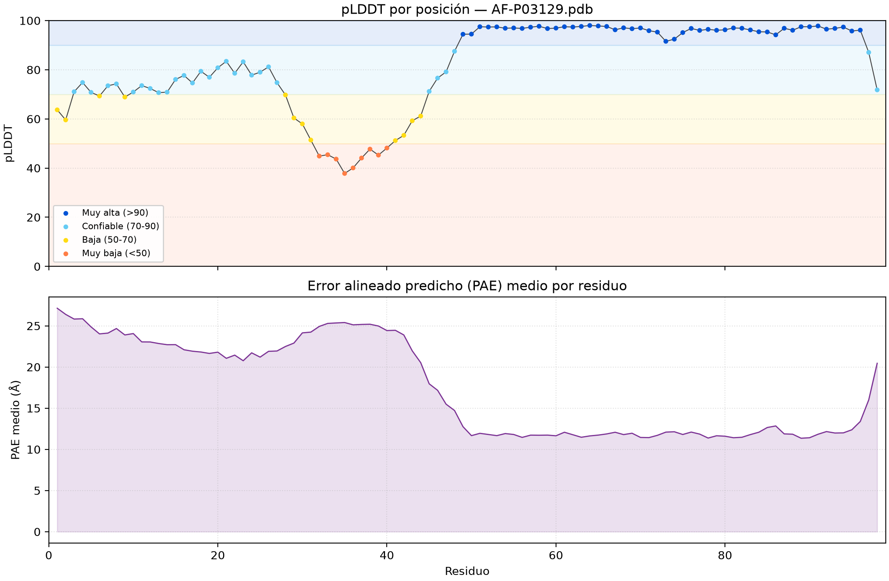

# La vida en tres dimensiones

**Trabajo práctico de Bioinformática Estructural**  
Leonardo Criado · noviembre de 2026

### Desafío VI — E7 del VPH16 con ColabFold

**Procedimiento en ColabFold.** Se abre el notebook
[AlphaFold2.ipynb](https://colab.research.google.com/github/sokrypton/ColabFold/blob/main/AlphaFold2.ipynb),
se pega la secuencia de E7 en `query_sequence`, se elige un `jobname`, se fija
`num_relax = 1` y `template_mode = "pdb100"`, y se ejecuta `Runtime → Run all`.
La secuencia es:

```
MHGDTPTLHEYMLDLQPETTDLYCYEQLNDSSEEEDEIDGPAGQAEPDRAHYNIVTFCCKCDSTLRLCVQSTHVDIRTLEDLLMGTLGIVCPICSQKP
```

**¿Qué es `template_mode` y qué opciones acepta?**
Controla si ColabFold usa plantillas estructurales para la predicción:

- `"none"`: no usa plantillas; predice solo a partir de la secuencia y del MSA.
- `"pdb100"`: busca plantillas en la base **PDB100** (representantes del PDB y
  modelos de AlphaFold DB; antes se llamaba PDB70) y las usa como información
  estructural. Es útil cuando hay homólogos estructurales conocidos.
- `"custom"`: permite subir plantillas propias en formato PDB o mmCIF (nombres de
  cuatro letras en minúscula); el notebook las usa para la búsqueda.

**Resultados.** En este repositorio se analiza el modelo de **AlphaFold DB** para
E7 (AF-P03129-F1, generado con ColabFold 1.5.2, 98 aa, pLDDT global 81,3), porque
la corrida de ColabFold con plantillas requiere GPU y una sesión de Colab. El
script `05_plddt.py` es exactamente el que se aplica al archivo
`*_relaxed_rank_001_*.pdb` que devuelve esa corrida; si se corre con
`template_mode="pdb100"`, los valores pueden cambiar levemente, pero la conclusión
estructural se mantiene.



| Región | pLDDT medio | Interpretación |
|---|---|---|
| 1–40 | 66,1 | Baja/media; el mínimo está en 32–40 (37,8–47) → región desordenada |
| 41–60 | 85,0 | Confiable |
| 61–98 | **95,4** | Muy alta; 49–96 tienen pLDDT > 90 |

**¿Qué regiones tienen mayor confianza?**
El **dominio C-terminal** (aproximadamente 61–98) es la región de mayor confianza:
pLDDT > 90 en casi toda la mitad C-terminal, con un promedio de 95,4. Es el dominio
con los motivos de dedos de zinc (CXXC) y la estructura globular estable. La región
**N-terminal** (1–40) tiene confianza media/baja y un tramo muy bajo entre 32 y 40,
lo que es consistente con una región **intrínsecamente desordenada** (CR1/CR2, que
incluye el motivo LXCXE de unión a pRb). El PAE acompaña: es alto en el extremo
N-terminal y bajo en el dominio C-terminal, lo que indica que la orientación
relativa del dominio C está bien determinada y la del N-terminal no.

Esto no es un defecto del predictor: es información biológica. E7 es una proteína
pequeña con un extremo N desordenado que media interacciones con socios celulares
y un dominio C estructurado que se une al zinc y dimeriza. AlphaFold2 predice con
alta confianza lo que es estable y con baja confianza lo que es flexible.

**El script `05_plddt.py`**

- Lee el archivo PDB y toma el pLDDT de la columna B-factor de los átomos CA.
- Grafica el pLDDT por número de residuo, coloreado por banda de confianza
  (>90, 70–90, 50–70, <50).
- Opcionalmente grafica el PAE medio por residuo a partir del JSON de PAE.
- Escribe un CSV con `residuo,plddt` y la figura PNG.
- Uso:

```bash
python src/05_plddt.py resultados/colabfold/mi_run_relaxed_rank_001_alphafold2_ptm_model_1_seed_000.pdb \
    --pae resultados/colabfold/mi_run_predicted_aligned_error_v1.json \
    --salida resultados/fig_plddt_E7.png \
    --csv resultados/tablas/plddt_E7.csv
```

**Archivos que produce ColabFold.** El notebook genera: `*_template_domain_names.json`
(plantillas usadas), `cite.bibtex`, `config.json` (parámetros de la corrida), `*.a3m`
(alineamiento), `*_coverage.png` (cobertura del MSA), `*_PAE.png` (mapa de PAE),
`*_plddt.png` (pLDDT por posición), `*_predicted_aligned_error_v1.json` (valores de
PAE), los cinco modelos `*_relaxed_*_model_*.pdb` y sus JSON con PAE/pLDDT. Los
modelos relajados con Amber (`num_relax=1`) tienen mejor geometría local; el
pLDDT se calcula antes de la relajación.

---

---

El contexto general, la metodología y las referencias completas están en el [informe integral](informe.md).
